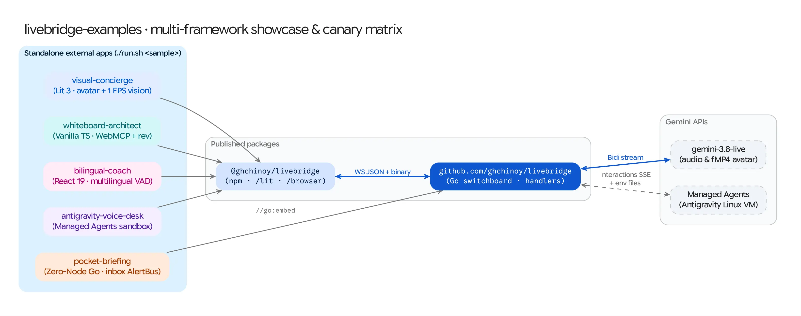
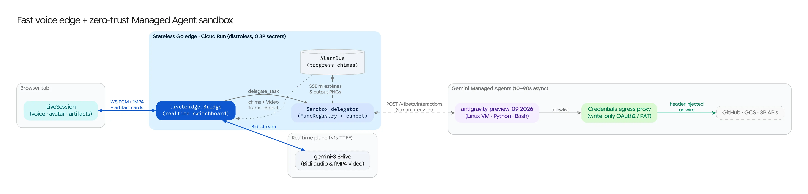

# livebridge-examples

[](https://github.com/ghchinoy/livebridge)
[](https://www.npmjs.com/package/@ghchinoy/livebridge)
[](https://github.com/ghchinoy/livebridge/releases/tag/v0.1.1)
[](LICENSE)

Multi-framework external showcase and release-canary applications built on [`github.com/ghchinoy/livebridge`](https://github.com/ghchinoy/livebridge) and [`@ghchinoy/livebridge`](https://www.npmjs.com/package/@ghchinoy/livebridge) across **Lit 3**, **Vanilla TypeScript**, **React 19**, **Zero-Node Go**, and **[Gemini Managed Agents](https://aistudio.google.com/docs/managed-agents-quickstart)**—consuming the published packages directly from `proxy.golang.org` and `npmjs.com` with zero `go.work` or `replace` directives.

<picture>
  <source media="(prefers-color-scheme: dark)" srcset="docs/assets/examples-overview-dark.webp">
  
</picture>

> **Ecosystem & Related Repositories:**
>
> - **[`ghchinoy/livebridge`](https://github.com/ghchinoy/livebridge)** owns the core Go & TypeScript libraries, the [Developer Guide](https://github.com/ghchinoy/livebridge/blob/main/docs/developers-guide.md), [Recipes](https://github.com/ghchinoy/livebridge/blob/main/docs/recipes.md), [Wire Protocol](https://github.com/ghchinoy/livebridge/blob/main/docs/wire-protocol.md), and 4 minimal CI-gated API unit recipes (`examples/01`–`04`).
> - **[Gemini Live Studio (`GoogleCloudPlatform/generative-ai`)](https://github.com/GoogleCloudPlatform/generative-ai/tree/main/gemini/multimodal-live-api/gemini-live-studio)** is the full Google Cloud reference application (persona studio, custom avatar image synthesis, and WCAG-audited UI) where `livebridge`'s architecture originated.
> - **`livebridge-examples` *(this repository)*** provides focused external domain applications across multiple UI frameworks (React 19, Lit 3, Vanilla TS, Zero-Node Go) plus a one-command switcher (`make use-local` / `make use-tarball` / `make use-npm`) for canary-testing `livebridge` releases.

## Contents

- [Prerequisites & Setup](#prerequisites--setup)
- [Quickstart (`./run.sh`)](#quickstart-runsh)
- [Sample Catalog](#sample-catalog)
- [Switching `@ghchinoy/livebridge` Source (`npm` / `local` / `tarball`)](#switching-ghchinoylivebridge-source-npm--local--tarball)
- [Local Verification & Quality Gates](#local-verification--quality-gates)
- [Troubleshooting](#troubleshooting)
- [Official Gemini 3.8 Live & Reference Documentation](#official-gemini-38-live--reference-documentation)
- [Contributing](#contributing)
- [License](#license)

---

## Prerequisites & Setup

- **Go** `1.26+` (`go version`)
- **Node.js** `22.23.4+` and **npm** `10+` (`node -v`)
- **Authentication:**
  - **Google Cloud ADC *([Gemini 3.8 Live Guide](https://docs.cloud.google.com/gemini-enterprise-agent-platform/models/guides/gemini-3-8-live); recommended, required for talking video avatars)*:**
    ```bash
    gcloud auth application-default login
    export GOOGLE_CLOUD_PROJECT="your-gcp-project-id"
    ```
  - **Gemini Developer API *([Google AI Studio `gemini-3.8-live` Docs](https://aistudio.google.com/docs/models/gemini-3.8-live); audio & tool samples)*:**
    ```bash
    export GEMINI_API_KEY="your-api-key"
    ```

Clone and install frontend dependencies from npm:

```bash
git clone https://github.com/ghchinoy/livebridge-examples.git
cd livebridge-examples
make install
```

---

## Quickstart (`./run.sh`)

Use `./run.sh` to start any sample's Go backend and Vite dev server together with automatic `Ctrl+C` cleanup:

```bash
# List all samples, stacks, and local URLs
./run.sh --list

# Launch any sample interactively:
./run.sh visual-concierge      # -> http://localhost:5181 (Lit 3 + Avatar + Camera/Screen)
./run.sh whiteboard-architect  # -> http://localhost:5182 (Vanilla TS + Shared Canvas)
./run.sh bilingual-coach         # -> http://localhost:5183 (React 19 + Roleplay & VAD)
./run.sh pocket-briefing         # -> http://localhost:8094 (Zero-Node Go + Inbox AlertBus)
./run.sh antigravity-voice-desk  # -> http://localhost:5185 (Gemini 3.8 Live + Managed Agents)
```

---

## Sample Catalog

Every sample has its own standalone `go.mod` importing `github.com/ghchinoy/livebridge v0.1.1` from `proxy.golang.org` and `package.json` importing `@ghchinoy/livebridge@^0.1.1` from npm:

| Sample | URL / Ports | Frontend Stack | Key `livebridge` Capabilities Proven |
| :--- | :--- | :--- | :--- |
| **[`visual-concierge`](samples/visual-concierge/)** | `:5181` (Go `:8091`) | **Lit 3** (`@ghchinoy/livebridge` + `/lit`) | `LiveSessionController`, `PRESET_AVATARS` + `defaultVoiceForAvatar`, `prepareAvatarImage` (`704x1280` / `1280x704`), `Fmp4Player`, 1 FPS webcam & screen `VisionCapture`, `FuncRegistry` (`upsert_checklist`). |
| **[`whiteboard-architect`](samples/whiteboard-architect/)** | `:5182` (Go `:8092`) | **Vanilla TypeScript** (`@ghchinoy/livebridge`) | `LiveSession`, `WebmcpToolHost` (`get_board` with monotonic `revision` + `readOnlyHint`/`untrustedContentHint`, `add_node`, `connect_nodes`, `highlight_node`, `clear_board` with `consequentialHint`), freehand pointer strokes + `SeeVisualResults` JPEG loop, 60 FPS `PcmPlayer.analyser` spectrum. |
| **[`bilingual-coach`](samples/bilingual-coach/)** | `:5183` (Go `:8093`) | **React 19** (`@ghchinoy/livebridge` + `useLiveSession`) | Idiomatic React 19 `EventTarget` hook, dynamic `LanguageCode` (`es-US`, `ja-JP`, `en-US`), `AdaptationPhrases`, tunable VAD `SilenceDurationMs` slider, `FuncRegistry` (`score_turn`). |
| **[`pocket-briefing`](samples/pocket-briefing/)** | `:8094` | **Zero-Node Go** (`livebridge/browser`) | Single Go binary (`//go:embed`), `./inbox/` `.md`/`.txt` watcher + `POST /api/memo`, `AlertBus` + `FormatUntrustedAlert` + `ChimeSynth`, `FuncRegistry` (`save_action_item`). |
| **[`antigravity-voice-desk`](samples/antigravity-voice-desk/)** | `:5185` (Go `:8096`) | **Lit 3 + [Managed Agents](https://aistudio.google.com/docs/managed-agents-quickstart)** | Stateless voice/avatar edge (`gemini-3.8-live`) delegating Python/Bash/chart work to an isolated `antigravity-preview-09-2026` Linux VM via async SSE (`google.golang.org/genai/interactions`), `AlertBus` chimes, `Interactions.Cancel`, and `/environments/{id}/files` PNG visual inspection. |

### Zero-Trust Voice Edge + Managed Agents Sandbox (`antigravity-voice-desk`)

<picture>
  <source media="(prefers-color-scheme: dark)" srcset="docs/assets/managed-agents-split-dark.webp">
  
</picture>

---

## Switching `@ghchinoy/livebridge` Source (`npm` / `local` / `tarball`)

By default, all frontends install `@ghchinoy/livebridge` from the public npm registry (`^0.1.1`). When developing unreleased changes in a sibling `../livebridge` checkout, [`scripts/switch-ts-source.mjs`](scripts/switch-ts-source.mjs) switches all three Vite frontends in one command:

```bash
# 1. Public npm registry (^0.1.1) — default for external consumers & CI
make use-npm VERSION=0.1.1

# 2. Local sibling checkout (file:../../../../livebridge) — fast local iteration
make use-local

# 3. Pre-publish npm pack rehearsal (.vendor/ghchinoy-livebridge-*.tgz)
make use-tarball
make verify
```

---

## Local Verification & Quality Gates

```bash
make lint      # gofmt -s, go vet, golangci-lint, and tsc --noEmit across all samples
make test      # Go -race unit & WebSocket integration tests across all 4 samples
make build-fe  # Production Vite builds across Lit 3, Vanilla TS, and React 19
make verify    # Full lint + test + Go binary builds + Vite production builds
```

---

## Troubleshooting

- **`GOOGLE_CLOUD_PROJECT` vs `GEMINI_API_KEY`:** Talking video avatars (`ModeAvatar` in `visual-concierge` and `bilingual-coach`) require Vertex AI (`GOOGLE_CLOUD_PROJECT` in `us-central1`). Audio-only mode works with either `GOOGLE_CLOUD_PROJECT` or `GEMINI_API_KEY`.
- **Custom avatar `1007` rejections:** `visual-concierge` automatically crops uploaded photos via `prepareAvatarImage` (`704x1280` or `1280x704`). Note that `CustomizedAvatar` also requires your GCP project to be allowlisted for custom avatars; the 11 built-in `PRESET_AVATARS` (`Kira`, `Ingrid`, `Jay`, `Paul`, `Vera`, `Sam`, `Ben`, `Kai`, `Leo`, `Carmen`, `Piper`) work without custom-avatar allowlisting.
- **Port already in use:** Override `PORT=8099` when starting a Go backend manually if `:8091`–`:8094` is occupied.

---

## Official Gemini 3.8 Live & Reference Documentation

- **[Gemini 3.8 Live Developer Guide (Google Cloud)](https://docs.cloud.google.com/gemini-enterprise-agent-platform/models/guides/gemini-3-8-live)** — Bidi streaming, talking video avatars, custom avatars, replicated voice, and proactivity on Google Cloud.
- **[Gemini 3.8 Live Model Card & Specifications (Google Cloud)](https://docs.cloud.google.com/gemini-enterprise-agent-platform/models/gemini/3-8-live)** — Regional endpoints (`us-central1`), supported modalities, and session limits.
- **[Gemini 3.8 Live Documentation (Google AI Studio)](https://aistudio.google.com/docs/models/gemini-3.8-live)** — Using `gemini-3.8-live` with the Gemini Developer API (`GEMINI_API_KEY`).
- **[Gemini Live Studio (`GoogleCloudPlatform/generative-ai`)](https://github.com/GoogleCloudPlatform/generative-ai/tree/main/gemini/multimodal-live-api/gemini-live-studio)** — Full Google Cloud reference application showcasing `livebridge`'s switchboard and browser media architecture.
- **[`ghchinoy/livebridge`](https://github.com/ghchinoy/livebridge)** — Core Go (`github.com/ghchinoy/livebridge`) and TypeScript (`@ghchinoy/livebridge`) libraries, [Developer Guide](https://github.com/ghchinoy/livebridge/blob/main/docs/developers-guide.md), [Recipes](https://github.com/ghchinoy/livebridge/blob/main/docs/recipes.md), and [Wire Protocol](https://github.com/ghchinoy/livebridge/blob/main/docs/wire-protocol.md).

---

## Contributing

Issues and pull requests adding new framework integrations or domain samples are welcome. For changes to the core Go switchboard or `@ghchinoy/livebridge` runtime, see [`ghchinoy/livebridge`](https://github.com/ghchinoy/livebridge). Ensure `make verify` passes before opening a PR.

---

## License

Apache License 2.0 — see [LICENSE](LICENSE).
