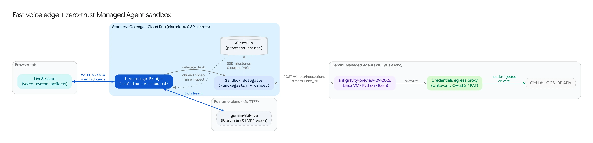

# Antigravity Voice Desk (Gemini 3.8 Live + Gemini Managed Agents Sandbox)

Pairs a **stateless `livebridge` voice/avatar edge (`gemini-3.8-live`)** with an isolated **[Gemini Managed Agents](https://aistudio.google.com/docs/managed-agents-quickstart) Linux sandbox (`antigravity-preview-09-2026`)** using `google.golang.org/genai/interactions`.

<picture>
  <source media="(prefers-color-scheme: dark)" srcset="../../docs/assets/managed-agents-split-dark.webp">
  
</picture>

## What It Proves

- **Zero-Trust Split:** The `livebridge` server runs zero shell commands and holds zero third-party secrets—all code execution, file generation, and external API calls happen inside Google's isolated Linux VM (`v1beta/interactions` + write-only `v1beta/credentials` egress proxy).
- **Non-Blocking Async SSE + `AlertBus`:** `delegate_sandbox_task` returns in `<5ms` so your voice/avatar conversation stays responsive while SSE steps (`code_execution`, `google_search`, `completed`) stream into the UI and trigger `ChimeSynth` + spoken briefings on completion.
- **Stateful Sandbox Continuity & Cancellation:** Preserves `(environment_id, previous_interaction_id)` across voice turns and wires `cancel_sandbox_task` + session teardown to `Interactions.Cancel`.
- **Visual Artifact Inspection:** Downloads generated charts (`/v1beta/environments/{id}/files/workspace/primes.png?alt=media`), displays them in the sidebar, and streams the PNG via `SendRealtime({Video})` so the voice/avatar model inspects the chart visually.

## Run

```bash
export GEMINI_API_KEY="your-api-key"          # Managed Agents v1beta + environment file download
export GOOGLE_CLOUD_PROJECT="your-project-id" # Optional: enables talking video avatars on Vertex AI
../../run.sh antigravity-voice-desk
# Opens Vite on http://localhost:5185 (proxying /ws to Go :8096)
```

## Verify

```bash
go test -race -v .
cd frontend && npm run build
```
